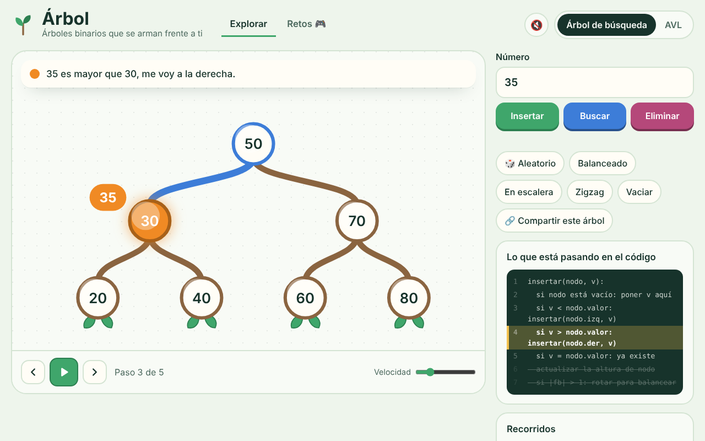
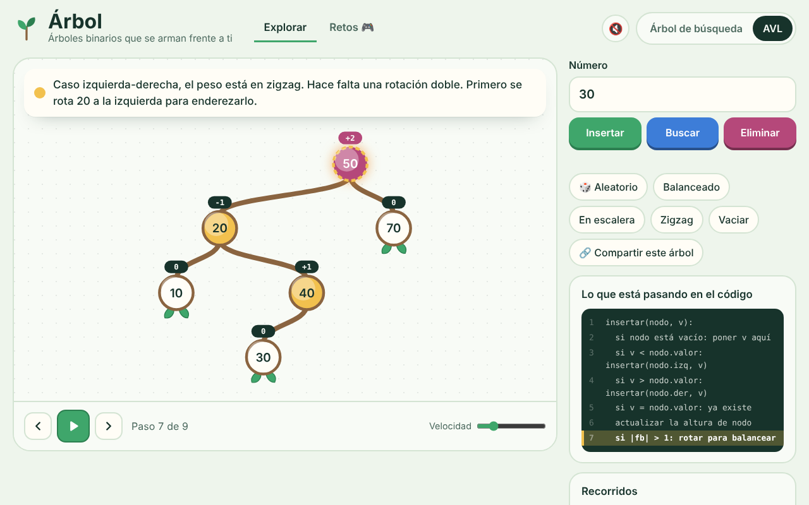
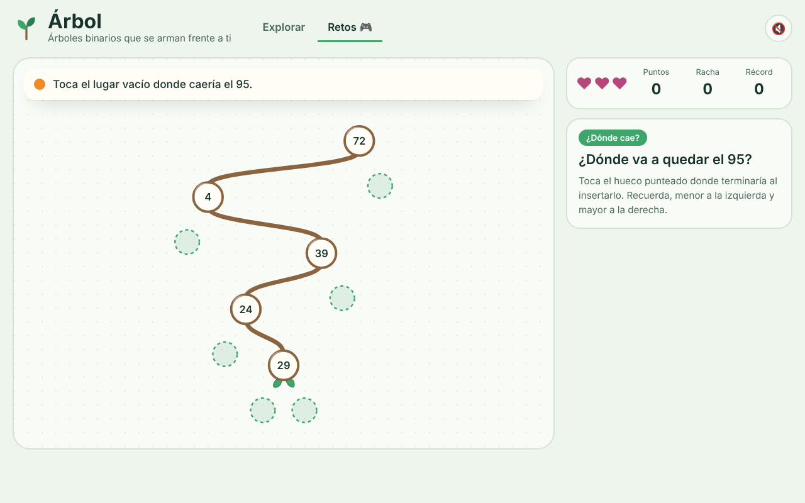
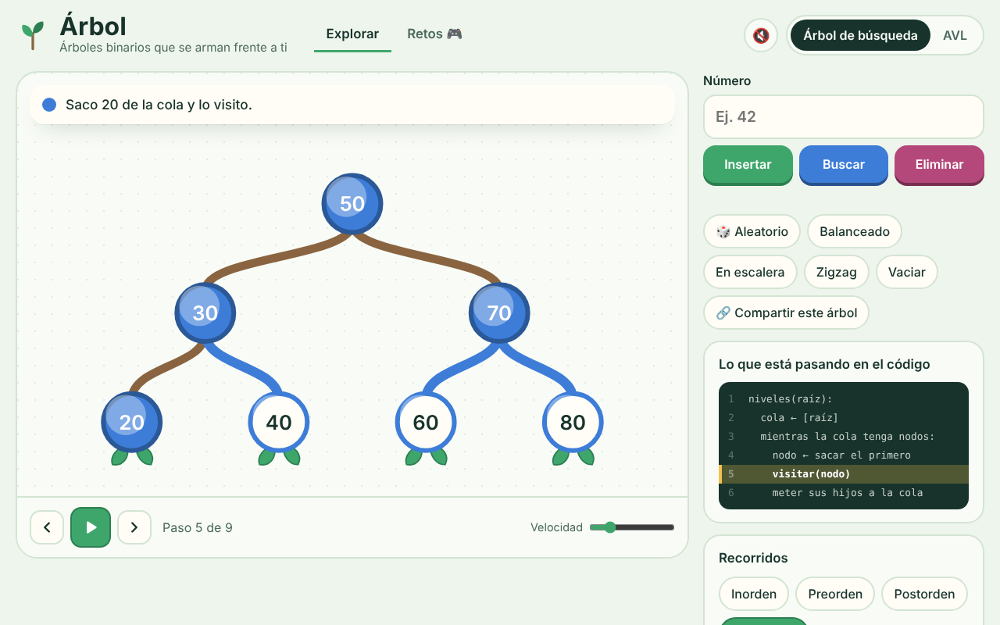
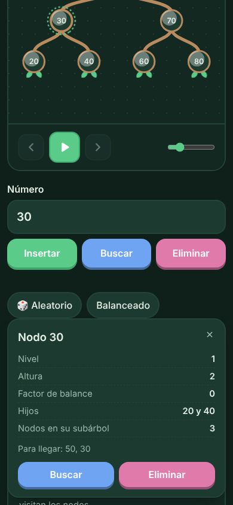

# Árbol

Árboles binarios que se arman frente a ti, paso a paso. Insertas un número y lo ves bajar comparando nodo por nodo hasta caer en su lugar. Para entender de verdad qué pasa en un árbol de búsqueda y en un AVL, y después ponerlo a prueba jugando.

**Probarlo:** https://said1ojeda.github.io/arbol/



## Qué se puede hacer

**Explorar**

- **Insertar, buscar y eliminar** con animación paso a paso. Cada paso dice qué se comparó y para dónde se fue, abajo se cuenta cuántas comparaciones lleva la operación, y el número va bajando en una pastillita junto al nodo.
- **Eliminar con sus tres casos**: si es hoja se quita, si tiene un hijo ese hijo sube, y si tiene dos se busca el sucesor y se copia.
- **Modo AVL** con el factor de balance encima de cada nodo. Cuando un nodo llega a +2 o -2 se ve la rotación, simple o doble, con los nodos acomodándose solos.
- **Los cuatro recorridos**: inorden, preorden, postorden y por niveles, con la lista que se va armando y la cola visible en el de niveles. Al terminar puedes copiar el orden para pegarlo donde quieras.
- **Pseudocódigo** al lado que ilumina la línea que se está ejecutando en cada paso.
- **Ficha del nodo**: tocas cualquier nodo y ves su nivel, altura, factor de balance, hijos, tamaño de su subárbol y el camino desde la raíz.
- **Datos del árbol**: nodos, altura, hojas, mínimo, máximo y si está balanceado, comparando la altura con la mínima posible.
- **Ejemplos** listos: balanceado, en escalera para ver por qué existe el AVL, zigzag para ver una rotación doble y uno lleno con todos sus niveles completos.
- **Compartir**: el enlace lleva el árbol armado, al abrirlo sale el mismo.

**Retos** 🎮

Tres vidas, puntos y racha. Cada acierto seguido da más puntos y a la quinta hay confeti.

- **¿Dónde cae?** Te dan un número y tocas el hueco donde quedaría al insertarlo.
- **Recorrido**: tocas los nodos en el orden que pide, inorden, preorden, postorden o por niveles.
- **Rotación**: un AVL quedó desbalanceado y escoges cuál de las cuatro rotaciones lo arregla.

Los árboles crecen conforme haces puntos, y el récord se guarda en tu navegador.

| AVL rotando | Retos |
| --- | --- |
|  |  |

| Recorrido por niveles | En el cel, de noche |
| --- | --- |
|  |  |

## Detalles

- **Los nodos hoja llevan hojitas.** Así se ve de un vistazo qué es una hoja del árbol. Y crecen para abajo, como en computación.
- **Cada operación guarda una foto del árbol en cada paso**, por eso se puede ir para atrás y para adelante, pausar o cambiar la velocidad.
- **Los nodos tienen un id que no cambia aunque se muevan**, y el dibujo los lleva de su lugar viejo al nuevo. Así una rotación se ve como movimiento y no como un brinco.
- **El acomodo usa el orden inorden para la posición horizontal**, entonces el árbol se lee de menor a mayor de izquierda a derecha y nunca se enciman los nodos.
- **Revisado con pruebas al azar**: cientos de árboles con inserciones y eliminaciones mezcladas, comparando contra una lista ordenada y revisando que el AVL nunca pase de factor 1.
- Sonido opcional, tema claro y oscuro según tu sistema, respeta la opción de reducir movimiento y se usa con teclado. Espacio pausa, las flechas mueven los pasos y la N o la diagonal te llevan directo a escribir el número. Escape cierra la ficha del nodo con más y menos cambias la velocidad, la R arma uno aleatorio y la V lo vacía. Con el signo de pregunta, o el botón de atajos, salen todos en una ventanita. Si lo imprimes o lo guardas en PDF sale solo el árbol con sus datos. El modo y la velocidad se quedan guardados para la próxima vez.

## Cómo está hecho

TypeScript estricto y SVG, sin librerías.

```
index.html       pantalla
css/estilos.css  el vivero, tema claro y oscuro
src/tipos.d.ts   tipos de pasos, fotos y marcas
src/arbol.ts     el árbol, cada operación devuelve sus pasos
src/pseudo.ts    el pseudocódigo de cada operación
src/dibujo.ts    dibuja y anima el árbol en SVG
src/sonido.ts    sonidos con Web Audio
src/retos.ts     el modo juego
src/app.ts       reproductor, botones y ficha del nodo
js/              lo compilado, no se edita a mano
```

## Correrlo en tu compu

Abre `index.html` en el navegador. El `js/` ya viene compilado.

Para modificarlo necesitas [Node.js](https://nodejs.org):

```
npm install
npm run watch
```

## Licencia

[MIT](LICENSE)
